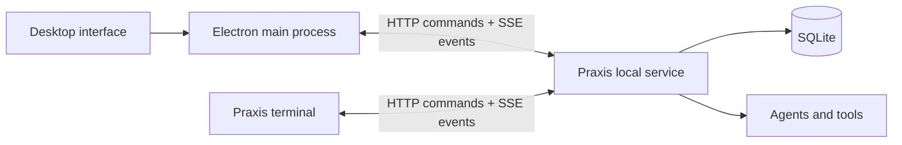

<p align="center">
  
</p>

<h1 align="center">Praxis Desktop</h1>

<p align="center">A desktop workspace for the sessions you run with Praxis.</p>

<p align="center">
  <a href="#get-started">Get started</a> ·
  <a href="https://github.com/aldercreek/Praxis">Python backend</a> ·
  <a href="#shared-sessions">Shared sessions</a> ·
  <a href="#development">Development</a>
</p>

Praxis-UI is an Electron client for [Praxis](https://github.com/aldercreek/Praxis). Follow agent work, review tool calls and file changes, preview documents, and send instructions from a desktop window. Your terminal and desktop connect to the same local service, so a session keeps running when a window closes.

> Under active development. The desktop currently runs from source with a separate Praxis Python checkout.

## Inside the workspace

- **Persistent conversations.** Reopen sessions and follow streaming responses from the same backend used by the terminal.
- **Visible execution.** Inspect tool arguments, command output, per-turn plans, subagent activity, and changed files.
- **Direct control.** Send follow-ups during execution, approve or deny tools, stop a turn, and resume or delete retained input.
- **Document previews.** Open text, Markdown, images, and PDFs alongside the conversation; reveal files in your system file manager.
- **Selection-to-quote input.** Select text from an answer or preview and use it as context in your next instruction.
- **Automatic reconnect.** Recover missed events from the last applied sequence while keeping the existing conversation on screen.

## Get started

Install **Node.js 22+**, npm, and the [Praxis backend dependencies](https://github.com/aldercreek/Praxis#get-started). A sibling checkout is discovered automatically:

```text
projects/
  Praxis/       # Python service and its .venv
  Praxis-UI/    # This repository
```

```sh
git clone https://github.com/aldercreek/Praxis-UI.git
cd Praxis-UI
npm ci
npm run dev
```

In **Settings**, select your workspace. If needed, choose the Praxis repository and its Python interpreter, then configure your model provider. The backend uses the Responses API.

You can provide `ADA_API_KEY`, `ADA_BASE_URL`, and `ADA_MODEL` through the environment. API keys saved in desktop settings use Electron's system-backed `safeStorage` encryption.

Build and run the compiled app:

```sh
npm run build
npm start
```

`npm run package` creates a local unpacked application. A separate Praxis Python environment is still required; the desktop package does not bundle the backend.

## Shared sessions



The desktop discovers the service, verifies its local token and identity, and starts an independent service if needed. Joining an existing service adopts its current model and approval settings. Only an explicit settings edit changes shared configuration; changes are rejected while a session is running.

Closing the desktop disconnects the client. **Use Stop to cancel a turn.** The service waits for cleanup and preserves input that has not been consumed. An approval answered in another client resolves here too.

To share sessions, use the same `PRAXIS_DATA_DIR` as the terminal. It defaults to `~/.praxis`. `PRAXIS_UI_DATA_DIR` controls desktop preferences separately and does not select a different backend.

When opening a conversation, the client subscribes before requesting a snapshot, then combines it with newer events. React acknowledges sequences after applying state. A disconnected stream reconnects from that acknowledgement; event replay updates the interface without resubmitting instructions or rerunning tools.

## Configuration

| Setting | Purpose |
| --- | --- |
| Workspace | Default directory for new sessions |
| Praxis directory / Python interpreter | Locate and launch the shared backend |
| Model / base URL / API key | Configure the backend's Responses API provider |
| Approval mode | Shared approval policy; cannot change during active turns |
| `PRAXIS_PATH` | Override automatic Praxis repository discovery |
| `PRAXIS_DATA_DIR` | Backend discovery, authentication, and session database |
| `PRAXIS_UI_DATA_DIR` | Desktop preferences and profile |

A newly created desktop service defaults to approval bypass. An existing service retains its own policy, which the desktop displays. Review the approval setting before starting work.

## Development

```sh
npm test                 # State, HTTP/SSE, presentation, and local-file unit tests
npm run build            # Type checking and production build
npm run test:e2e         # Electron workflow tests; build first
npm run test:integration # Desktop client against the real Python service
```

The integration test expects a sibling `Praxis/.venv`; override it with `PRAXIS_PATH` and `PRAXIS_PYTHON`. It exercises the actual Python service and SQLite with an offline model substitute. Electron tests use isolated profiles and a deterministic HTTP/SSE fixture. Neither suite calls a paid model.

| Module | Responsibility |
| --- | --- |
| `src/main/service-discovery.ts` | Service registration, identity checks, independent launch |
| `src/main/event-subscription.ts` | SSE parsing, heartbeat timeout, replay cursor, reconnect |
| `src/main/backend-client.ts` | HTTP operations and session subscriptions |
| `src/main/local-files.ts` | Validated file access, preview, open, and reveal |
| `src/preload/` | Narrow IPC bridge with context isolation |
| `src/renderer/src/state.ts` | Snapshot/event reconciliation and view state |
| `src/renderer/src/usePraxis.ts` | UI actions and applied-event acknowledgements |
| Renderer components | Conversation, execution, file previews, and quoted input |

The renderer runs with sandboxing and without Node integration. Network access and local file operations go through the main process. Execution, input deduplication, approvals, and persistence belong to the Python service.

For bug reports, include your operating system, reproduction steps, and relevant diagnostics in [GitHub Issues](https://github.com/aldercreek/Praxis-UI/issues). Remove API keys and private conversation data before sharing logs.
